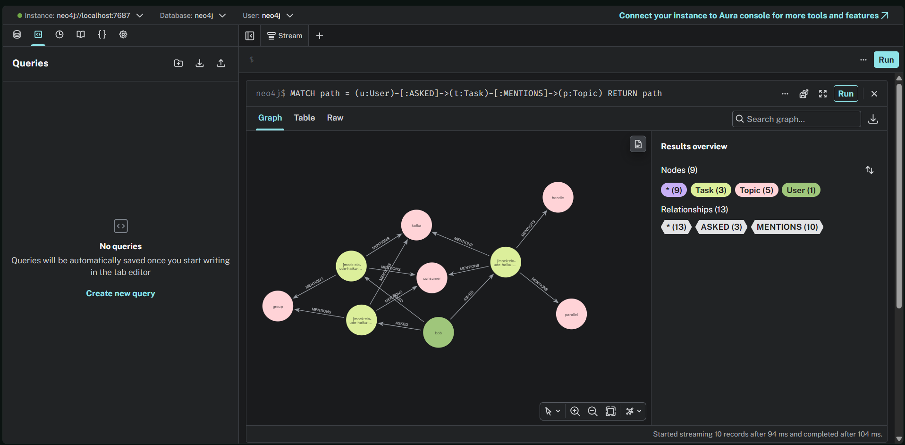
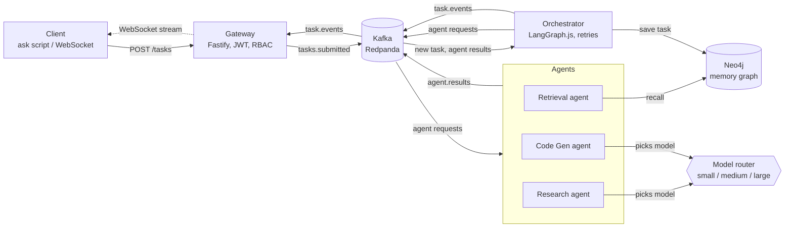
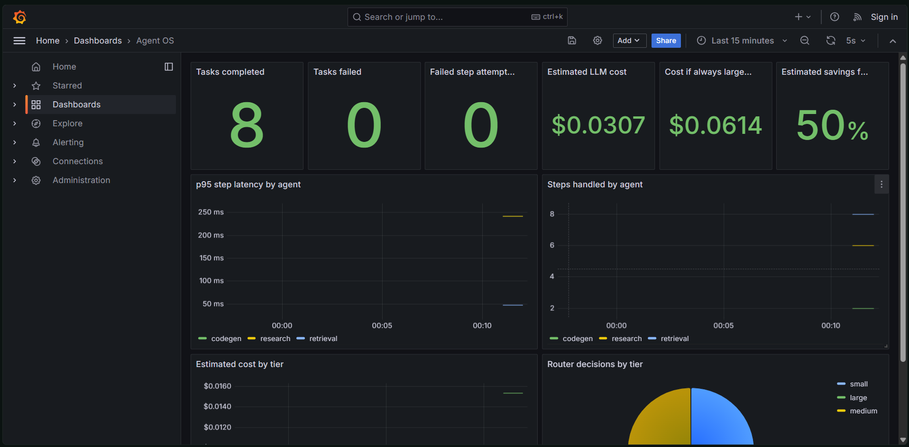

# Agent OS (TypeScript)



## Architecture



**How a request flows**

1. The client sends a question to the gateway, which checks the JWT and the user's role.
2. The gateway publishes the task to Kafka.
3. The orchestrator runs a LangGraph workflow: retrieve context, then route to Code Gen or Research.
4. Each agent picks the cheapest model tier that can handle the question.
5. Progress events flow back through Kafka and the gateway to the client over WebSocket.
6. When a task completes, it is saved to the Neo4j graph so later questions can recall it.

Multi-agent LLM platform: Fastify gateway -> Kafka (Redpanda) -> DAG orchestrator -> agents.




## Run it

```bash
npm install
npm run infra:up            # Redpanda, Neo4j, Postgres
# in separate terminals:
npm run dev:gateway
npm run dev:orchestrator
npm run dev:retrieval
npm run dev:research
```

## Try it

```bash
TOKEN=$(curl -s localhost:3000/auth/login -H 'content-type: application/json' \
  -d '{"username":"bob","password":"dev123"}' | jq -r .token)

# terminal A: watch events (npx wscat -c "ws://localhost:3000/ws?token=$TOKEN")
# terminal B: submit a task
curl -s localhost:3000/tasks -H "authorization: Bearer $TOKEN" \
  -H 'content-type: application/json' -d '{"prompt":"How does Kafka handle parallel consumers?"}'
```

Viewer role (`carol`) gets 403 on POST /tasks. Redpanda Console: http://localhost:8080

## Flow
POST /tasks -> `tasks.submitted` -> orchestrator runs DAG (retrieve -> research) via
`agent.<name>.requests` / `agent.results` -> `task.events` -> gateway -> WebSocket.
## Windows (PowerShell) instructions

The commands above are for Mac/Linux. On Windows, use these instead.

Start the agents (one terminal each):

```powershell
$env:AGENT_NAME="retrieval"; npm run dev -w @aios/agents
$env:AGENT_NAME="research"; npm run dev -w @aios/agents
```

Log in, watch events, and submit a task:

```powershell
# Terminal A: log in and watch live events
$token = (Invoke-RestMethod -Uri "http://localhost:3000/auth/login" -Method Post -ContentType "application/json" -Body '{"username":"bob","password":"dev123"}').token
npx wscat -c "ws://localhost:3000/ws?token=$token"

# Terminal B: log in again, then submit a task
$token = (Invoke-RestMethod -Uri "http://localhost:3000/auth/login" -Method Post -ContentType "application/json" -Body '{"username":"bob","password":"dev123"}').token
Invoke-RestMethod -Uri "http://localhost:3000/tasks" -Method Post -ContentType "application/json" -Headers @{ Authorization = "Bearer $token" } -Body '{"prompt":"How does Kafka handle parallel consumers?"}'
```

## Status

Phase 1 complete: gateway (JWT, RBAC, WebSocket), Kafka event bus, DAG orchestrator, Retrieval and Research agents. The LLM is mocked unless `ANTHROPIC_API_KEY` is set.

Planned: LangGraph.js orchestration, more agents, LLM cost router, Neo4j memory graph, AKS deployment, observability.

## What I learned

- A port conflict (Postgres on 5432) is fixed by remapping the host port in docker-compose.
- CLI flag order matters: `tsx watch --env-file=...`, not the other way around.
- Environment variables are set differently on Windows and Mac/Linux, so scripts need `cross-env` or per-shell commands.
- Event-driven systems need per-instance consumer groups when a service must receive every message.